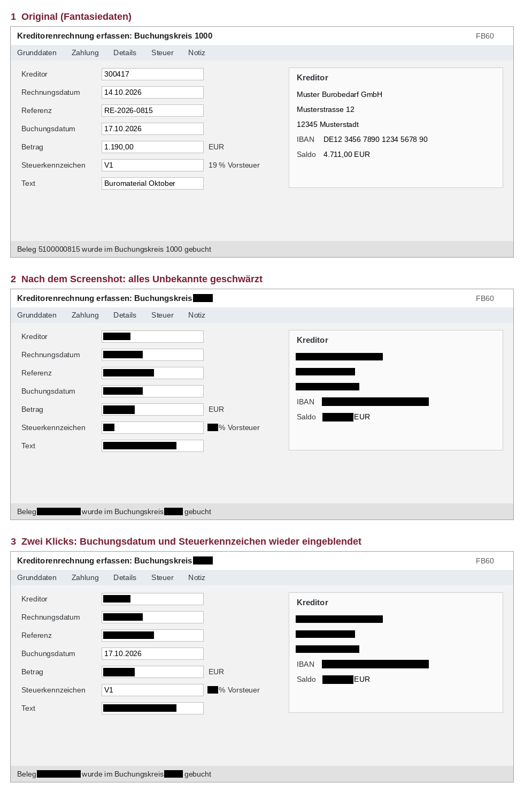

# SAP-Schwärzer – Anleitung

Der SAP-Schwärzer schwärzt Kundendaten in Screenshots, **bevor** du sie in Copilot oder Word einfügst.
Feldnamen bleiben lesbar, Werte werden schwarz. Alles läuft nur auf deinem PC.

## Einmalig einrichten

1. Den Ordner `schwaerzer` auf deinen PC kopieren, z. B. nach `Dokumente\SAP-Schwaerzer-Programm`.
2. Doppelklick auf **`Pruefen.cmd`**. Es öffnet sich ein Fenster mit einer Liste:
   - Alles grün **[OK]** → weiter mit Schritt 3.
   - Etwas rot **[FEHLT]** → Hinweis lesen. Typische Fälle:
     - *Texterkennung Deutsch fehlt*: Einstellungen → Zeit und Sprache → Sprache → Deutsch → Sprachoptionen → „Optische Zeichenerkennung“ installieren.
     - *Skriptausführung gesperrt / eingeschränkter Sprachmodus*: Das legt die IT fest. Bitte **nicht umgehen**, sondern die IT fragen.
     - *„… ist nicht digital signiert“*: Die Dateien kamen aus dem Internet oder per Mail. Rechtsklick auf `SAP-Schwaerzer.ps1` → Eigenschaften → unten **„Zulassen“** ankreuzen → OK.
3. Optional für den Autostart: `Win+R` → `shell:startup` → Enter. In den geöffneten Ordner eine **Verknüpfung** zu `Starten.cmd` legen.

## Täglich benutzen

1. Doppelklick auf **`Starten.cmd`**. Unten rechts erscheint ein **Schild-Symbol** (eventuell unter dem Pfeil ^).
2. In SAP: **`Win+Shift+S`** → Bereich aufziehen.
3. Es öffnet sich ein Fenster mit der **Vorschau**:
   - **„Kundendaten schwärzen“** ist angekreuzt. Alles Unbekannte ist schwarz.
   - **Klick auf einen schwarzen Balken** blendet genau diesen Wert wieder ein. Ein zweiter Klick schwärzt ihn wieder.
     Gedacht für Werte, die man eingeben muss: Periode, Geschäftsjahr, Buchungskreis, Variante …
   - Häkchen weg = Original ohne Schwärzung (z. B. bei Selektionsbildern ohne Kundendaten).
4. **Einmal kurz hinschauen:** Ist noch ein Name, eine IBAN oder ein Betrag lesbar, der nicht lesbar sein soll? Dann draufklicken.
5. **„Übernehmen“** klicken (oder Enter). Danach mit **`Strg+V`** in Copilot oder Word einfügen.
   „Verwerfen“ (oder Esc) löscht den Screenshot.

Bis du „Übernehmen“ klickst, ist die Zwischenablage **leer**. Das Original kann also nicht aus Versehen eingefügt werden.

**Bilder für Word:** Jedes übernommene Bild wird zusätzlich nummeriert gespeichert unter
`Dokumente\SAP-Schwaerzer\<Datum>\Bild-01.png`, `Bild-02.png` … Rechtsklick auf das Schild → **„Bilder-Ordner öffnen“**.
Abschalten: Rechtsklick → Häkchen bei „Bilder nummeriert speichern“ entfernen.

## Ein Feldname wird geschwärzt, soll aber lesbar sein

1. Rechtsklick auf das Schild → **„Feldnamen bearbeiten“**.
2. Den Feldnamen **genau so, wie er in SAP steht**, in eine neue Zeile schreiben. Speichern.
3. Rechtsklick auf das Schild → **„Feldnamen neu laden“**.

**Nie Werte eintragen** (keine Kreditorennummern, Namen, IBANs, Beträge). Alles in der Liste ist in **jedem** Screenshot lesbar.

## Pause

Wenn du andere Bilder kopierst (z. B. aus PowerPoint), die nicht geprüft werden sollen:
Rechtsklick auf das Schild → Häkchen bei **„Aktiv“** entfernen. Kopien aus Excel, Word oder dem Browser, die Text enthalten, lässt der Schwärzer ohnehin in Ruhe.

## Was der Schwärzer nicht kann

- **Er ersetzt nicht deinen Blick.** Die Texterkennung kann sich irren. Dunkle Schrift, die sie nicht erkennt, wird zwar vorsichtshalber geschwärzt, aber farbige Schrift (rot, blau) nur, wenn sie erkannt wird.
- **Dunkle SAP-Designs** (weiße Schrift auf dunklem Grund) werden noch nicht zuverlässig behandelt. Bitte ein helles Design verwenden.
- **Das Snipping Tool speichert eventuell selbst Originale** unter `Bilder\Bildschirmfotos`. Abschalten: Snipping Tool öffnen → `…` → Einstellungen → „Originale Screenshots automatisch speichern“ aus.
- **Der Zwischenablage-Verlauf** (`Win+V`) kann das Original behalten. Einträge dort mit `…` → Löschen entfernen, oder den Verlauf in Einstellungen → System → Zwischenablage ausschalten.

## Was gespeichert wird

| Was | Wo | Wann |
|---|---|---|
| Übernommene Bilder (geschwärzt oder bewusst freigegeben) | `Dokumente\SAP-Schwaerzer\<Datum>` | nur mit Häkchen „Bilder nummeriert speichern“ |
| Originale, erkannte Texte | nirgends | nie |

Nichts wird ins Internet gesendet. Die Texterkennung ist die eingebaute von Windows und läuft offline.

## Testbetrieb mit Bilddateien

Rechtsklick auf das Schild → **„Bilddatei schwärzen …“** → Bilder auswählen. Neben jedem Bild entsteht `<Name>_geschwaerzt.png`.
Für den Testsatz siehe `TESTSATZ.md`.
